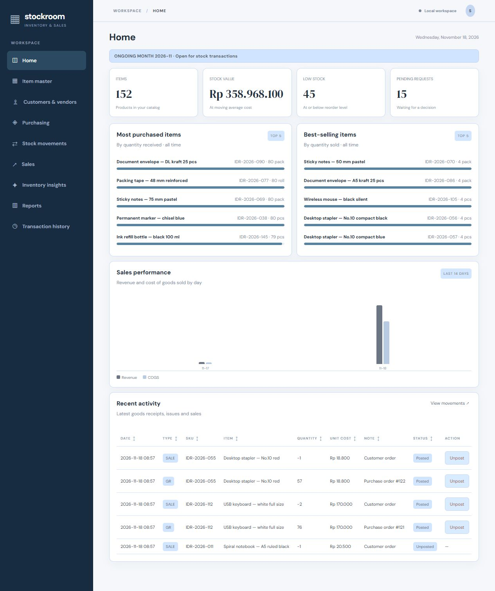

# Portfolio projects

- **AI Document Summarizer** — upload documents and get answers with supporting passages. Choose the [Ollama version](ai-document-summarizer/ollama/README.md) for local models or the [OpenAI version](ai-document-summarizer/openai/README.md) for an API-backed version.
- **Inventory & Sales Tracker** — a Go and MySQL inventory app with purchase requests and approvals, multi-line orders, receipts and issues, sales, moving-average COGS, item history, and optional local AI insights with Ollama. See [screenshots, features, and setup](inventory-tracker/README.md).

These are local portfolio demonstrations without login or user isolation. Do not expose them to the internet or upload sensitive data without further security work.

