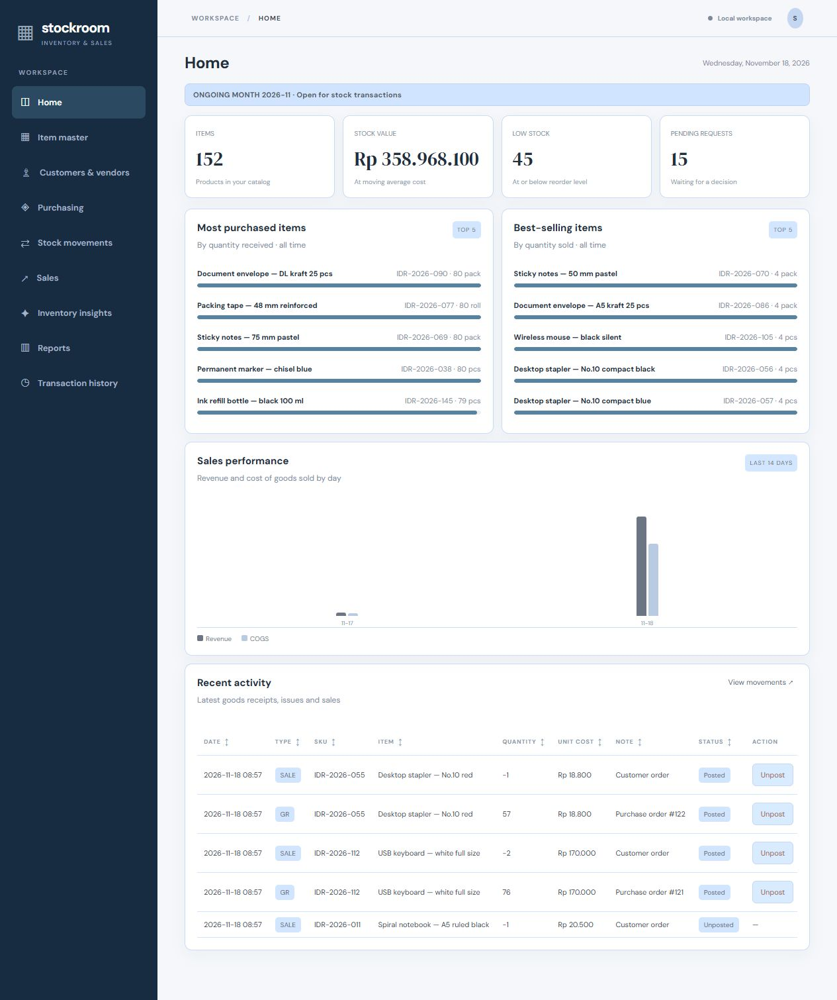
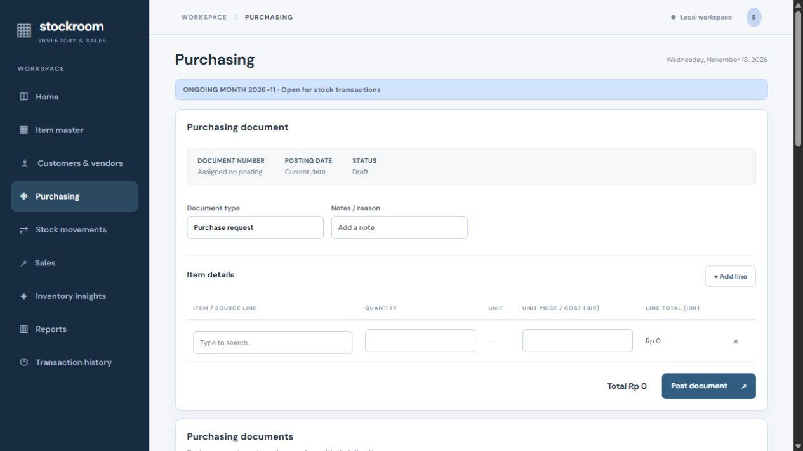
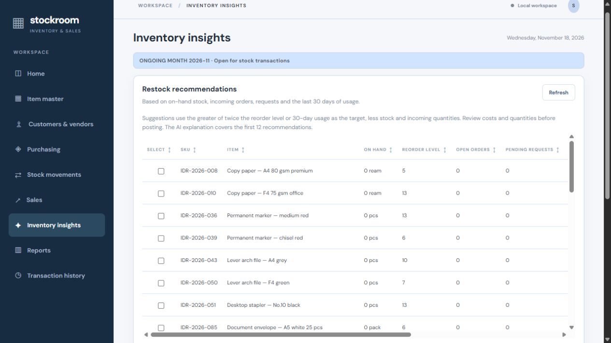
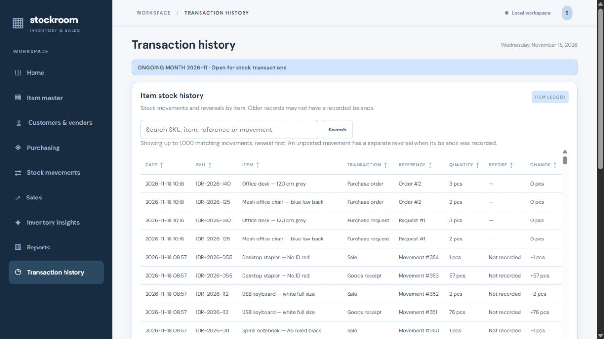

# Inventory & Sales Tracker

A local Go and MySQL portfolio app for item master data (SKU, name, brand, category and unit), purchase requests and approvals, purchase orders, goods receipts (GR), goods issues (GI), sales, moving-average cost of goods sold (COGS), stock valuation, monthly closing and change history. The interface uses plain HTML, CSS and JavaScript served by Go, keeping setup lightweight and avoiding a separate frontend build for this small application. New purchasing, receipt, issue and sales documents have a header and multiple detail lines. Their line postings update the existing stock ledger atomically. Previous single-item transactions remain available in the earlier-transactions sections.

## Screenshots

The screenshots show an illustrative local inventory workspace.

### Dashboard

### Purchasing

### Inventory insights

### Transaction history

## Run locally

Requirements: Go 1.22 or newer and Docker with Docker Compose. Ollama is optional for AI explanations; the inventory app and calculated recommendations work without it.

1. From this directory, run `docker compose up -d` to start a local MySQL 8.4 database on port 3307. The Compose credentials are example values intended for local development only.
2. Run `go run .` and open http://127.0.0.1:8080. The app creates its schema on first start.
3. To add the optional illustrative dataset, leave the app running and execute `go run ./cmd/seed-market --apply` from a second terminal. Use only with the intended database: the command adds records and cannot be applied twice.
4. For AI explanations, install Ollama, run `ollama pull llama3.2:3b`, and start Ollama. No OpenAI key is required for this feature.

For an existing MySQL installation, set `MYSQL_DSN` to its connection string with `parseTime=true&multiStatements=true`. The database account needs CREATE, ALTER, INDEX, TRIGGER, SELECT, INSERT and UPDATE privileges. The example Compose configuration disables binary logging for local trigger creation. Never use the example credentials for a real deployment.

Windows users can also run `./start-local.ps1` after starting the database. This repository does not contain any personal local configuration or database contents.
## Inventory and period workflow

1. Create a brand and category, then add an item.
2. Create and approve a purchase request; create a purchase order from it.
3. Receive the order in one or more goods receipts. A request line can be ordered once and its order quantity must match the request; partial receipts are supported. Receipt cost changes the item's moving average cost.
4. Record goods issues or sales. Sales save the unit cost at posting time and report COGS as quantity × unit cost.
5. The ongoing month is the only open stock-posting period. Transactions use the database server's current date and the app does not accept backdated dates. When the calendar moves to the next month, stock posting is blocked until the previous month is closed. Run the open-month recalculation if needed, then close the ended month from Reports. The close saves an item-by-item stock quantity, unit COGS and value, and opens the next month. If several months elapsed, close them one at a time.
6. Recalculation replays the open month's movements from the preceding closed snapshot. It validates stock and sale links and rolls back on discrepancies. It never changes closed-month sales costs or closing snapshots. Closed periods cannot be reopened through the app. Monthly COGS here means moving-average unit cost; actual COGS expense is shown in sales and sales reports.

MySQL triggers save before/after snapshots for master data, requests, orders, movements, sales, recalculations, monthly balances and period changes in `transaction_history` within the same database transaction. Existing records present when history is first enabled are labeled `BASELINE`; earlier changes cannot be reconstructed. The history module searches the complete history and loads older records in pages of 100.

## Boundaries

This is a simplified local demonstration, not an accounting system: there are no user accounts, role-based approvals, journal entries, multiple warehouses, taxes, returns, foreign currencies, period reopening or production-grade decimal arithmetic. Amounts are stored to four decimal places; calculation currently uses floating-point arithmetic. It does not implement Odoo or SAP in full. Do not expose it to the internet or rely on it for financial reporting without security, accuracy and accounting review.

## Design references

Period closing and valuation were informed by the inventory valuation and stock closing concepts in [Odoo documentation](https://www.odoo.com/documentation/19.0/applications/finance/accounting/get_started/inventory_valuation.html), and the effects of prior-period goods movements described in [SAP documentation](https://help.sap.com/docs/SAP_S4HANA_CLOUD/af9ef57f504840d2b81be8667206d485/475fb6531de6b64ce10000000a174cb4.html). This demo chooses a stricter simplified rule: it does not permit prior-period posting or reopening through the app.

## Testing

`go test ./...` skips the integration test unless `INVENTORY_TEST_DSN` is set. To run the full test, create a new, empty disposable MySQL database with the same permissions as the application account, set `INVENTORY_TEST_DSN` to its DSN (including `parseTime=true&multiStatements=true`), and run `go test -v ./...`. The test intentionally changes its database, including simulated past-period records; never point it at the application database. It covers request approval, partial receipts, multi-line documents, atomic rollback, insufficient stock, moving-average COGS, item editing, monthly close, history, and closed-period protection.

## Illustrative Indonesian market dataset

The optional `cmd/seed-market` command adds 150 office-supply items, 150 purchase requests, 120 purchase orders and receipts, 120 sales, 110 goods issues, and fictional vendor and customer names. It uses the current open inventory period and cannot be applied twice. Prices are illustrative IDR estimates, not supplier quotes. The script assigns purchase costs below approximate retail prices and uses the recorded moving average for issues and sales. It also updates the specifically recognized original chair example from its earlier placeholder pricing. Existing non-matching records are not changed.

Reference price ranges checked on 18 November 2026 included [ruparupa office furniture listings](https://www.ruparupa.com/c/shop-the-look/home-office-essentials/meja-kursi-kerja.html), [Monotaro stationery listings](https://www.monotaro.id/k/store/bantex%20a4%201450), and [Monotaro office supplies catalogue](https://media.monotaro.id/mid02/docs/flyer_70.pdf). Prices, stock and promotions vary; individual generated entries should not be represented as real offers or exact brand/model prices.

Back up the intended database first, verify that `MYSQL_DSN` points to it, and then run `go run ./cmd/seed-market --apply` from this folder. The command is transactional and guarded against repeat application and SKU collisions.

## Editing and unposting

Current-month pending purchase requests and purchase orders with no received goods can be edited. Editing an unposted request or order keeps it unposted; use Post to submit it again. Posted orders display their fulfillment status separately; ordered request items and quantities, and order items and quantities, remain tied to their approved source. The editor changes existing lines and does not add or remove lines.

Unposting is available in the current open month. Requests with active downstream orders and orders with received goods cannot be unposted until their dependencies are resolved. A posted receipt, goods issue or sale can be unposted only when no later active stock movement exists for any affected item. Unposting a receipt restores the order's outstanding quantity. Unposting a sale or issue restores stock; unposting a receipt removes it and replays the remaining current-month movements from the last closing balance. Sale and movement records remain visible as unposted, the audit trail records the change, and reports exclude unposted values. To correct an unposted stock document, create a new document; stock-document reposting is not implemented. Closed-period records cannot be edited or unposted through the application.

Item stock history lists purchase requests, orders, receipts, issues, and sales by item, together with signed stock changes. New postings and unposts record the stock balance before and after each movement. Older movements without captured balances show Not recorded; purchase requests and orders do not change stock. The ledger displays up to 1,000 matching records. The separate audit history contains other record changes and approvals.

## Local inventory insights

Inventory insights calculates restock suggestions from on-hand stock, outstanding open purchase orders, pending or approved requests that do not have an active order, and posted sales and issues over the last 30 calendar days. When projected stock is at or below the reorder level, the target is the higher of twice the reorder level or 30-day usage; the suggested quantity is the target less projected stock, rounded up. Pending requests are treated as potential incoming stock, not guaranteed receipts. This is a simple rule, not a demand forecast. Review seasonality, supplier lead times, missing history and the estimated cost. Select suggestions to prepare an editable purchase request; nothing is posted automatically, and an item with no recorded cost needs an estimated cost entered manually.

The daily figures use the MySQL server's current date and count receipt, issue, sale and request lines. AI explanations are optional and generated only when requested. Install and start Ollama with `llama3.2:3b`, then start the app as usual. The app defaults to `http://127.0.0.1:11434`; optional environment variables `OLLAMA_URL` and `OLLAMA_MODEL` override the endpoint and model. A locally running model requires no OpenAI key. Inventory facts and item names are sent to the configured Ollama endpoint, so keep it local if the data must stay on this computer. Generated text can be inaccurate; the calculated table and facts remain available if Ollama is unavailable.
